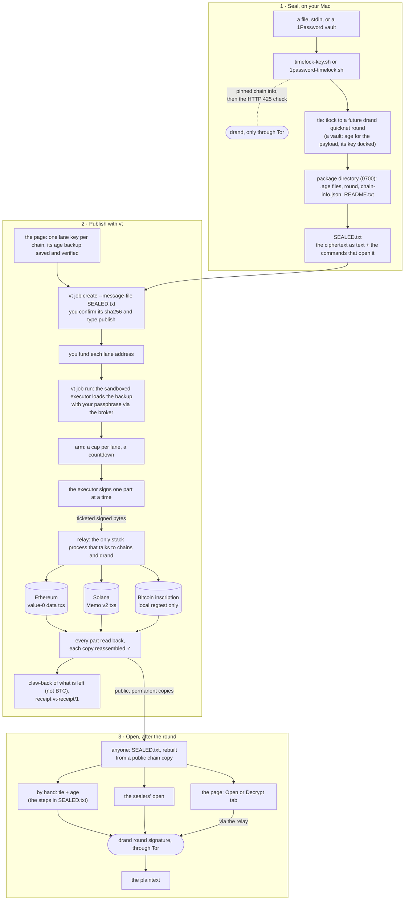
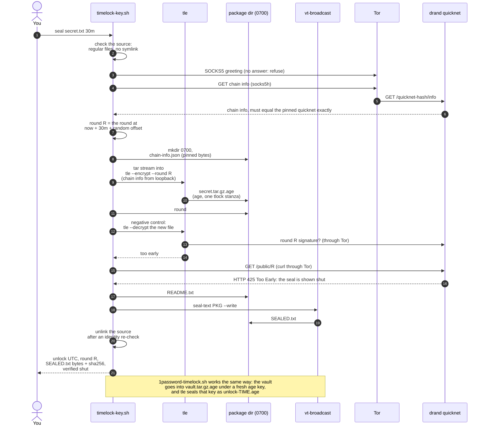
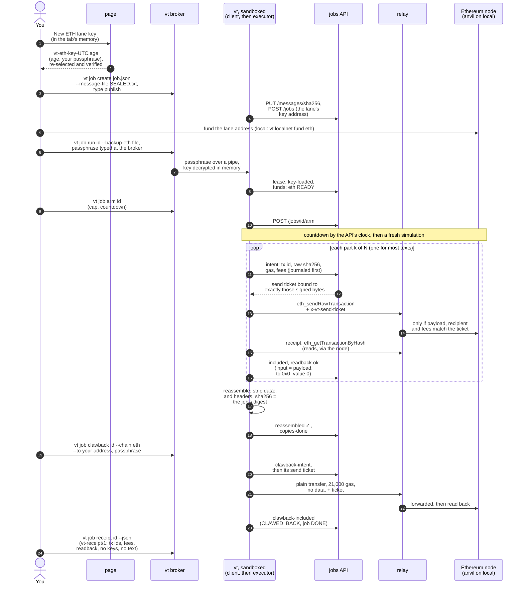
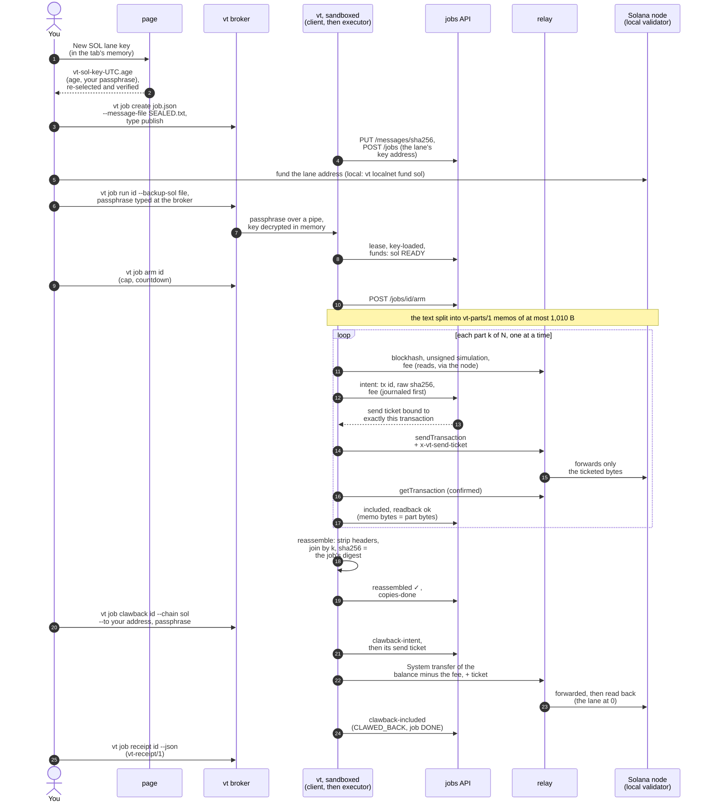
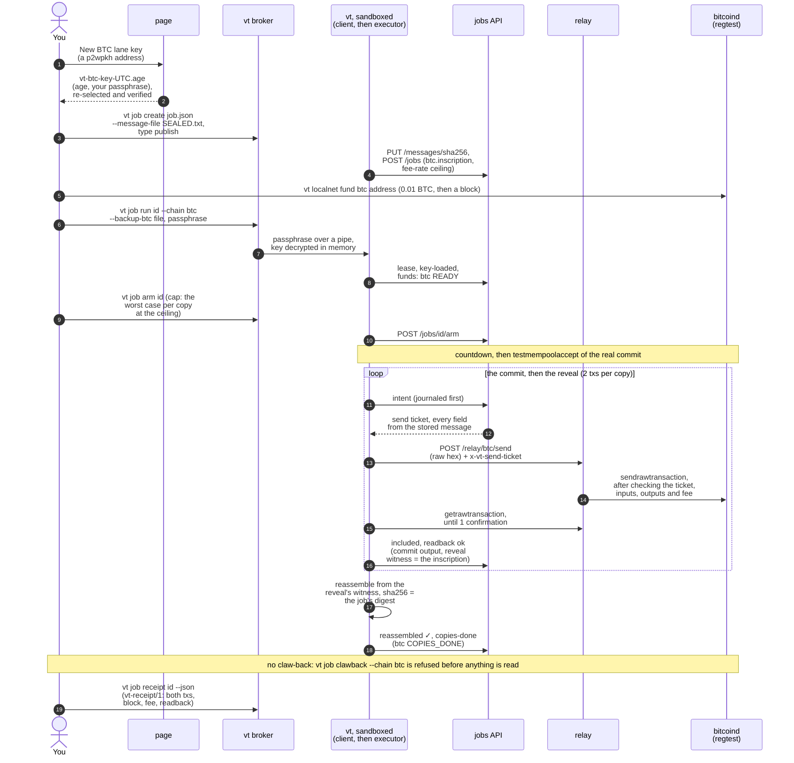
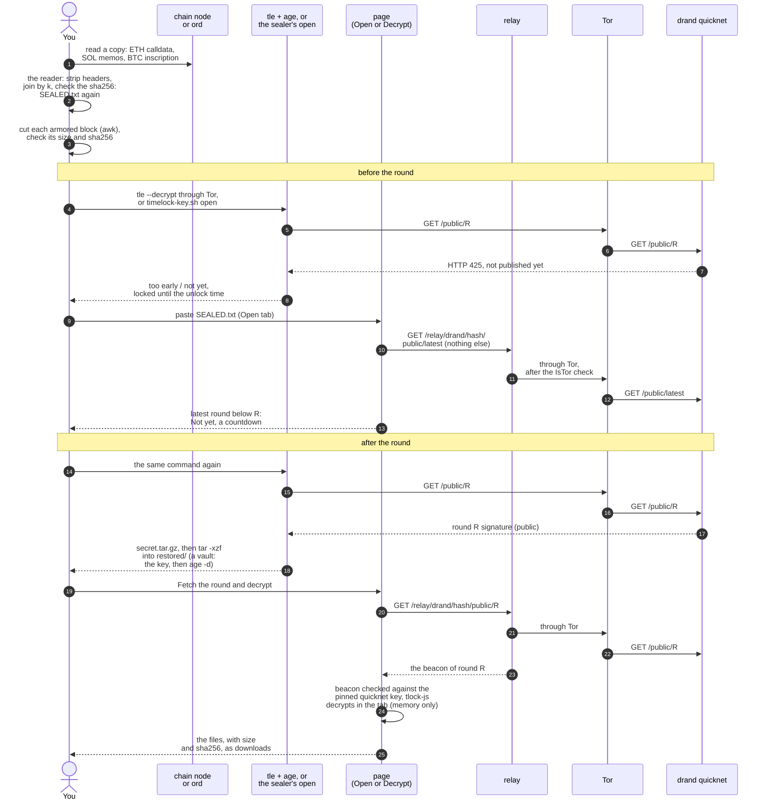

# vault-timelock

Timelock data so that it cannot be opened before a chosen date, and publish the sealed result where it
cannot be taken down.

- **Seal.** `timelock-key.sh` seals any file or stdin, and `1password-timelock.sh` seals a whole 1Password
  vault, to a future round of drand's League of Entropy `quicknet` beacon: **tlock** for the time layer and
  **age** for the payload. Nobody can open the package before that round's signature exists, unless a
  threshold of drand's key shares is combined or BLS12-381 is broken (`docs/CRYPTO.md`). Every seal ends
  with **`SEALED.txt`**: one self-contained text that holds the ciphertext, the pinned drand parameters and
  the literal commands that open it.
- **Publish.** `vt` puts that text on public chains: Ethereum (value-0 data transactions) and Solana (Memo v2
  transactions), with Bitcoin inscriptions on a local regtest only for now. Each chain gets its own lane key,
  per-lane spend caps and a claw-back for what is left. Every copy is read back from the chain and checked.
- **Open.** After the date, anyone with the text can open it: with the tools here, with `tle` and `age` by
  hand (the commands are in `SEALED.txt`), or in the page's **Open** tab.

`vt` is a CLI (`bin/vt`) plus a local web page. For each network, `vt up` starts three processes on loopback
in a tmux session, each in its own macOS sandbox: a relay (the only process that talks to chains and to drand),
a jobs API, and a page server.

| Path | What it is |
|---|---|
| `1password-timelock.sh`, `timelock-key.sh` | the sealers (POSIX sh; `--self-test` in each) |
| `cli/`, `bin/vt` | the `vt` command: stacks, local chains, jobs, releases, the sandbox broker |
| `api/` | the jobs API, the chain/drand relay and the page server |
| `web/` | the page (React + Vite): jobs, keys and backups, status/pre-flight, Open |
| `packages/core` | shared engine: contracts, fees and parts, executor, gates, the `SEALED.txt` parser |
| `broadcast/` | `vt-broadcast`, the Tor-confined broadcaster (a standalone package with its own lockfile) |
| `test/integration` | end-to-end runs against a local stack |
| `docs/` | `vt.md` (operator guide), `E2E.md` (workflow), `CRYPTO.md` (the construction) |

## How it works

Three phases: **seal** on your Mac, **publish** the sealed text with `vt`, and **open** it after the round. The
overview is below; each step has its own sequence diagram under it. They were traced from a run on the local network
(a synthetic three-line secret sealed for 30 minutes, then published on each local chain and opened) and checked
against the code.

In the diagrams, **vt broker** is the small unsandboxed process that owns your terminal. Every `vt job …` command runs
sandboxed behind it, shown as **vt, sandboxed**: a client for `job create`, `arm` and `receipt`, and the executor for
`job run` and `job clawback`, the only two that hold a key. The page's **Run here** is the other executor. The diagrams follow the terminal path from `docs/E2E.md` §0.1.



<details>
<summary><b>Seal</b>: <code>timelock-key.sh seal</code> (<code>1password-timelock.sh</code> adds an age layer)</summary>

- Every drand request goes through Tor (`socks5h`, `127.0.0.1:9050`); if Tor does not answer, the sealer refuses
  (`--clearnet` is the only opt-out). The chain info drand returns must equal the pinned quicknet info exactly, and
  `tle` encrypts with those pinned bytes, served to it on loopback.
- The round is the one at *now + duration + a random offset* (by default up to min(24 h, duration/10), never
  printed), so the round does not date the seal. No plaintext file is written: `tar` streams straight into `tle`.
- The seal must be shown to be shut before it succeeds: `tle --decrypt` says "too early" and drand answers HTTP 425 for
  the round. Only then are `README.txt` and `SEALED.txt` written and the source file unlinked (a directory is kept).
- Example: the three-line secret gave `secret.tar.gz.age` of 10,599 B and a `SEALED.txt` of 18,237 B: the format line
  `vault-timelock-sealed/1`, the unlock time and round, the drand parameters, `tle` v1.2.0, the numbered open steps
  and each `.age` file as an armored block with its size and sha256.



</details>

<details>
<summary><b>Ethereum</b>: value-0 data transactions</summary>

- Each part is one EIP-1559 transaction with value 0 (the code refuses any other value), sent to the null address by
  default. Its calldata is `data:,` + the part header + the chunk, at most 98,304 B, so a typical `SEALED.txt` is one
  transaction: the 18,237 B example went out as one tx of 18,243 B calldata. Longer texts are split into `vt-parts/1`
  parts (`[k/N h8]`, part 1 also carries the text's sha256).
- Gas is the fork's calldata formula (21,000 + 40 per byte before Amsterdam). The node's estimate must agree with it.
- The executor journals each intent and gets a send ticket before the bytes leave. The relay forwards only bytes that
  match the ticket: payload, recipient, fees. A part is read back (input, recipient, value 0) before the next is
  signed. A mismatch on readback or reassembly stops the lane.
- Claw-back is a plain transfer with no data (21,000 gas to an existing account): value + fee = the lane's balance.
  Above what is left of the armed cap, you type the exact amount.



</details>

<details>
<summary><b>Solana</b>: Memo v2 transactions</summary>

- Each part is one legacy transaction with one signer (the lane key pays the fee): `setComputeUnitLimit`
  (+ `setComputeUnitPrice` only when priced) and one Memo v2 instruction with no accounts. A signed tx fits in 1,232 B,
  so a memo carries at most 1,010 B.
- Parts are `vt-parts/1`: `[1/N h8 sha256=…]` on part 1, `[k/N h8]` after. The 18,237 B example became 19 memo
  transactions (18 × 1,010 B + 443 B), 5,000 lamports each.
- Parts go one at a time: part k+1 is signed only after part k is confirmed and its memo bytes read back equal.
- Claw-back is one System transfer of the balance minus its fee, so the lane ends at 0.



</details>

<details>
<summary><b>Bitcoin</b>: an ordinals inscription, local regtest only</summary>

- **Local only for now:** a testnet or mainnet BTC job is refused, and there is **no claw-back**: what is left stays on
  the lane key (keep its backup).
- One copy is one inscription (`text/plain;charset=utf-8`, at most 100,000 B, the text verbatim), so two
  transactions: a commit that pays a taproot address only the inscription script can spend, then a reveal that spends
  it by that script and leaves 546 sat of postage on the lane's own taproot address. The reveal is built only after
  the commit landed.
- The fee rate is the node's estimate, never above the job's ceiling (1 to 500 sat/vB). The 18,237 B example: a
  153 vB commit and a 4,724 vB reveal at 2 sat/vB, 10,300 sat in all.
- One confirmation; `vt localnet` mines a block every 5 s. The job page links the inscription on your local `ord`,
  which only observes: the executor reads `bitcoind` through the relay.



</details>

<details>
<summary><b>Open</b>: rebuild the text from a chain, then open it after the round</summary>

- Anyone with a copy can rebuild `SEALED.txt`: the job page's "Reassemble by hand" command (`cast` or `curl`, plus
  `python3`) takes parts only from the publishing address, strips each header line, joins the parts by index and checks
  the sha256. A Bitcoin copy is the inscription's content, verbatim. The run's SOL and BTC copies were byte-identical
  to the original.
- Before the round all three ways refuse: `tle` says "too early", the sealers say "not yet — locked until" the UTC
  time, and the page shows a countdown. Open asks only for drand's `public/latest`; Decrypt sends nothing at all.
- After the round, the round's signature is public. `tle`, or tlock-js in the page's tab, decrypts with it; a vault's
  data key then opens `vault.tar.gz.age` with `age`. The page never contacts drand itself: it goes through the relay's
  `/relay/drand/…` route, which uses Tor, and the beacon is checked against the pinned quicknet key.
- In the run, `tle` by hand, `timelock-key.sh open` and the page's decrypt code (over the same relay route) gave the
  same file, with the original's sha256.



</details>

## Requirements

- **macOS.** The sandboxes use `sandbox-exec`, and the sealers rely on macOS `tar`/`libarchive` behaviour.
  Run it on a single-user Mac (`docs/vt.md`, "First mainnet run").
- **Node.js 24** (`>= 24.13.0`) and **npm 11.21.0**, run through `npx`. Do not use the system npm for the
  workspaces: older npm versions link `@vault-timelock/core` and the `file:` packages to the wrong paths.
- **Tor**, with its SOCKS port on `127.0.0.1:9050` (`brew install tor && brew services start tor`). drand is
  only ever reached through Tor; testnet and mainnet stacks refuse to start without it.
- **The sealers:** `age`, `jq` and drand's `tle` (`brew install age jq`;
  `go install github.com/drand/tlock/cmd/tle@v1.2.0`). The 1Password CLI (`op`) is needed only to seal a real
  vault; the self-tests use a synthetic stand-in.
- **`tmux`.** `vt` runs its stacks on its own tmux server (`tmux -L vt`).
- **The local network** (`vt localnet up`): Foundry's `anvil` (`brew install foundry`), Agave's
  `solana-test-validator` (<https://docs.anza.xyz/cli/install>), and for the BTC lane Bitcoin Core's `bitcoind`
  (`brew install bitcoin`) and `ord` 0.29.0 exactly. Docker is optional (Otterscan). `vt localnet up` names any
  missing tool with its install hint.
- Optional: Google Chrome (`vt up --open`), Foundry's `cast` and `python3` (reassembling a text by hand).

## Install

From the repository root:

```sh
npx --yes npm@11.21.0 ci --ignore-scripts      # the workspaces: packages/core, api, cli, web
(cd broadcast && npm ci --ignore-scripts)      # broadcast/ has its own lockfile
npm run -w web build                           # the page bundle (web/dist) that vt up serves
```

Install scripts are off (`.npmrc`: `ignore-scripts`, exact pins, `install-strategy=linked`).
`scripts/test-root.sh` checks the links first and refuses a wrong install with the exact fix command.

## Quickstart: the local network

Nothing here spends real funds: the chains are local (anvil, a Solana test validator, a regtest bitcoind).

```sh
# A development tree needs both directories set explicitly (a release tree may use the defaults).
export VT_HOME="$(mktemp -d)" VAULT_TIMELOCK_DIR="$(mktemp -d)"

bin/vt localnet up                     # anvil :8545, solana-test-validator :8999, bitcoind regtest + ord, Otterscan
bin/vt up --network local --open       # relay, API and page; prints http://127.0.0.1:5180/ and opens it
bin/vt preflight --network local       # the readiness table; exit 0 = ready
```

Then, on the page: create a job, make an ETH and a SOL lane key, download each key backup and verify it, fund
the lanes (`bin/vt localnet fund eth|sol|btc <address>`), arm, and run. The same steps from the terminal
(`vt job create|arm|run|status|clawback|receipt`) are in `docs/E2E.md` §0.1. Stop with
`bin/vt down --network local` and `bin/vt localnet down` (the chain data is kept). `bin/vt help` lists every
command.

## Sealing a 1Password vault

Sealing a real vault is something **you** run, in your own terminal, signed in to `op`. Nothing in this
repository's tests, CI or tooling reads a real vault. Do a dry run first:

```sh
sh ./1password-timelock.sh --self-test     # synthetic fake `op`, a temporary output dir; drand through Tor
```

Then seal (directly, or through `vt seal vault`, which prints the command and runs the same script):

```sh
./1password-timelock.sh seal "<vault name>" 10 --recovery-recipient age1…   # 10 years; see DURATION below
```

The package lands in `$VAULT_TIMELOCK_DIR` (default `~/.local/share/vault-timelock/`). Only its `SEALED.txt` is
meant to be published: `vt job create … --message-file <package>/SEALED.txt` refuses every other file in a
package directory, and asks you to confirm the file's sha256 and type `publish`.

## Safety model

- **Sandboxed processes, no terminal.** The relay, API, page server and the `vt` client and executor commands
  each run under `sandbox-exec` with a scrubbed environment (`env -i`), networking limited to the loopback ports
  each one needs (only the relay talks to chains and to drand), and no access to `/dev/tty` or any pty.
- **Broker prompts.** A small unsandboxed broker owns the terminal. It asks only for what the command's own
  arguments allow: a key-backup passphrase (echo off) or a typed word from a fixed list (`publish`,
  `broadcast`, `again`, `ticks`, an amount, `claw back`, …). It never forwards free text, and it filters the
  command's output (no escape sequences or invisible characters).
- **Publishing is explicit.** A message file comes only from the command line, never from a job file, and
  passes a denylist (keys and credentials, vt's state, sealer work directories, everything in a package except
  `SEALED.txt`). You confirm its sha256 before anything is uploaded. What is published is public, permanently.
- **Mainnet only from a verified release.** `vt up --network mainnet` refuses a development tree. Build and
  verify a release from a clean tree (`vt release build`, `vt release verify <id>`), then run `vt` from it.
  Pre-flight must pass, the page's five checks must be ticked, and Arm needs typed confirmations and the
  per-lane cap. Each mainnet lane must name a claw-back address of your own.
- **Funding stays locked.** On mainnet only the job sends (the ETH and SOL publications and their claw-backs)
  are enabled. Every other mainnet send (funding, Privacy Cash withdrawals, BTC, Arweave) stays behind
  `MAINNET_SEND_ENABLED = false`. You fund lane keys yourself, from your own wallet.
- **drand only through Tor.** A clearnet request for a future round would tie your IP to a package
  (details below). `--clearnet` is the only opt-out, and it says so.
- **Key material stays in memory.** Lane keys live in the page's tab or the executor's memory. Only
  age-encrypted backups, under your passphrase, are ever written. Keep a copy off the machine.

The full threat model and the construction are in `docs/CRYPTO.md`. The runbook (pre-flight, first mainnet run,
backups, recovery, releases, the Arm gate) is `docs/vt.md`. The end-to-end workflow is `docs/E2E.md`.

---

## The sealers

```sh
./1password-timelock.sh seal "Private" 10 --recovery-recipient age1…
./1password-timelock.sh open <package-dir>                    # after the date
./1password-timelock.sh open <package-dir> --identity key     # any time, with the key
./timelock-key.sh seal <path|-> [DURATION]                    # the general case
./timelock-key.sh duration 1y30d                              # the seconds a DURATION means
```

`DURATION` is a bare number of **years** (the default, 10), or one or more `N<unit>` terms with no
spaces, units in the order `y d h m s`: `30d`, `1h`, `40m`, `365d`, `1y30d`, `1d12h`, `90s`. `m` is
minutes (there is no month unit: say `30d`), `y` is 31,556,952 s (the Gregorian mean). Zero, signs,
decimals, repeated or out-of-order units and anything beyond 100 years are refused. Both tools share
the same grammar, byte for byte, and print the exact UTC unlock time and drand round they sealed to.

`--armor` (either tool's `seal`) writes **every** `.age` file ASCII-armored (`-----BEGIN AGE ENCRYPTED
FILE-----`, 64-column base64), names unchanged, plus a marker file `ARMOR` containing `pem`. `open`
reads both forms: `age -d` and `tle --decrypt` detect armor by content.

**drand is reached only through Tor**. `tle --decrypt` asks drand for the exact
future round before it can say "too early", and a publication later prints that round, so a clearnet
request would tie your IP to the package. Both tools send every drand request (curl and every `tle`
call, in `seal`, `open` and `--self-test`) through Tor's SOCKS port `127.0.0.1:9050` as
`socks5h://drand.<UTC minute>:x@…` (names resolve inside Tor; its own circuit), refuse to run when Tor
does not answer, and pin quicknet's chain hash, genesis time, period, public key and scheme (parsed as
JSON; a repeated key refuses). `tle` encrypts with exactly that pinned chain info, served to it on
loopback (it would otherwise trust its own fetch for the scheme, which the chain hash does not bind). A
seal is shown to be shut by the local clock, `tle`'s "too early" and drand's HTTP 425 for the round. `--clearnet` is
the only opt-out, and it says so in the banner and the README; a package sealed with it must be
re-sealed over Tor before it is published anywhere.

Every seal ends by writing **`SEALED.txt`**, the self-contained text to publish: the `.age` files as
text, the drand parameters, pinned tool versions and the literal commands that open the package (the
self-tests run those commands exactly as printed). Both tools add a **random offset** (default up to
min(24 h, duration/10); `--jitter`) to the target round, so the round does not date the seal, and
write archives with neutral metadata (owner `nobody`, no xattrs, gzip time 0). `1password-timelock.sh`
also fetches and verifies every attachment, keeps the account metadata and 1Password's ids out of the
sealed items (pseudonyms instead; `--keep-item-metadata`, `--keep-item-ids`), seals a one-line data
key, and audits what it is about to encrypt for operator strings and 1Password identifiers (any hit
refuses; counts and categories only).

Both carry `--self-test`. Run it first; it is the only thing that distinguishes *locked* from
*broken*.

Both tools write packages to `~/.local/share/vault-timelock/` (`$XDG_DATA_HOME` if set; override
with `VAULT_TIMELOCK_DIR=<dir>`), never the cwd, in a new `0700` directory, and `open` takes either a
path or a bare package name from there. `timelock-key.sh seal -` streams stdin straight into `tle`
(raw, no tar, no temp file) as `payload.age` + `encoding` (`raw`). ★ `open` extracts **plaintext** into `<package>/restored/` — inside
that directory, which Time Machine backs up by default. Move or remove `restored/` when done.
`open` never writes through anything already in the package: it refuses if `restored` exists in any
form (a directory, a file, a symlink), `timelock-key.sh open` writes into a new
`<package>/opened-<UTC time>/`, and every archive is listed before extraction and refused unless all
entries are regular files or directories with relative paths and no `..`; it is then extracted without
macOS metadata (`--no-mac-metadata`: a `._` AppleDouble member would otherwise merge into the next
entry) and checked again ON DISK: only regular files and directories, no xattrs, no ACLs.

---

## ★★★ The one thing to understand before trusting this

**There is no way to make a file undecryptable-until-a-date with local computation alone.** A date is
not a secret — anything you can compute now, an attacker can compute now. Every real scheme borrows
the passage of time from something outside your machine, and the only question worth asking is what
that something is and whether it will still be there.

These tools use **drand timelock encryption (tlock)** on the League of Entropy `quicknet` chain.
drand publishes a threshold BLS signature every 3 seconds; tlock encrypts to a future **round**, and
the decryption key *is* the signature at that round. Fewer than t key shares cannot produce it early
(under BLS12-381's assumptions); t or more shares together can, at any time and without trace, whether
their holders collude or the shares are stolen or compelled, and shares from before a reshare count.

★★ **So the bet is: does the League of Entropy still run this chain, with this public key, in ten
years?** For **availability** that is a network-survival bet, and it is the thing most likely to fail.
**Confidentiality** before the date is a separate bet: that fewer than t key shares are ever combined and
that BLS12-381 holds, which a large quantum computer would end. quicknet's genesis is 2023-08-23. **Ten years is a long time to ask of any
infrastructure** — which is why both tools support a second, human path, and why the generated
READMEs tell you to store a Shamir split alongside.

### What was considered and rejected

| approach | why not |
|---|---|
| **Sequential-work puzzles / VDFs** (Rivest LCS35) | Genuinely trustless — needs nobody. But you calibrate in squarings-per-second on *today's* hardware. Rivest's own 35-year puzzle fell in 2 months to a better implementation. **Over a decade the calibration error exceeds the horizon.** |
| **An executor, a lawyer, a safe-deposit box** | Not a timelock — a person. Fine as a *second* path, useless as the only one. |
| **A cloud KMS key with a scheduled policy** | A vendor's access control, changeable by that vendor, a court, or whoever holds the account in ten years. |

---

## `1password-timelock.sh` — the vault case

### ★★★ The fact the whole tool is built around

From `op item get --help`:

> `--reveal   Don't conceal sensitive fields.`

**So `op` conceals by default.** An export written without it is a file of concealed values that is
the right size, has the right item count, passes every structural check a careless script would
run — **and restores nothing.**

The tool passes `--reveal`, and every other decision follows: the stream then carries every secret
you own, so it never leaves a `0700` directory, is never printed, and is never summarised by
anything but a count or a hash.

### Completeness is proved, not assumed

Three independent counts must agree — **any two agreeing is the failure mode**, because a truncated
capture is internally consistent:

1. what 1Password declares (`op item list --include-archive`)
2. what the manifest captured
3. that every declared id appears in the manifest

Then the payload arms, which are **population tests, not per-item rules**:

| observed | means | verdict |
|---|---|---|
| **100 %** of items blank | `--reveal` did not take effect | **refuse** |
| **some** blank, others populated | those entries are genuinely empty | **report by UUID, continue** |

★ `--reveal` is a *per-invocation* flag: it works for every item or none, so a concealed export fails
**uniformly**. A few blank items beside a populated majority is *positive evidence that it worked*.
An earlier per-item rule got this backwards and refused to back up a correct vault — the kind of
guard whose failure mode is "declines to run on valid input", which just trains you to disable it.

Finally, **seal proves it unseals** before destroying the data key: it decrypts the real ciphertext,
extracts it, and checks every item against its manifest digest. Sealing without unsealing is the
whole class of backup that fails on the day it is needed.

### PII discipline

What these tools may emit, exhaustively: **counts, item UUIDs, SHA-256 digests, and the vault name
you typed.** Never titles, usernames, passwords, URLs, emails, notes, TOTP seeds or filenames.

★ **Titles are PII.** *"Chase — joint account"* names a bank and a relationship. Progress output is
`42/57`, and the manifest keys on UUID for the same reason.

### Two unlock paths, and what the second one costs

`tle` accepts *rounds* only and cannot carry a second recipient, so the payload is encrypted once to
a fresh age key and that key is sealed twice, independently:

- `unlock-TIME.age` — sealed to the drand round; opens itself when the round lands
- `unlock-KEY.age` — sealed to a recipient you hold; opens **at any time**

★★ **A recovery key defeats the timelock.** Anyone holding it opens the package today, so the lock
then binds only people who do not. That is the right trade if your fear is *"drand disappears and
this is lost forever"*, and the wrong one if your fear is *"somebody opens this early"*. Sealing
without `--recovery-recipient` emits no `unlock-KEY.age` and leaves time as the only way in.

---

## On destroying the original

`timelock-key.sh seal <file>` **unlinks** (deletes) the file once the package verifies; it never
deletes a directory source (it says so: verify the package, then delete it yourself), and if `tar`
fails or archives anything other than exactly what `find` lists, nothing is sealed and the source is
untouched. A source that is a symlink (also as `linkdir/`), or that holds a symlink, a hard-linked file,
a FIFO, socket or device, is refused at seal time (`open` would refuse those entries at unlock time);
a file is deleted only if it is still the very file that was sealed (inode, size, mtime, ctime). Neither tool overwrites what it deletes (on current macOS
`rm -P` has no effect and there is no `shred`). **On APFS and on any SSD an overwrite would not be a
guarantee anyway** — copy-on-write may leave the old blocks intact, and wear levelling means the drive
decides where bytes go, not the filesystem. *Deleted but recoverable* is the honest description.
`1password-timelock.sh` writes the revealed items, briefly, into a private `0700` work dir under
`$TMPDIR` (the seal's round-trip check extracts there too); traps remove it on success, failure,
Ctrl-C and TERM.

What actually protects it: FileVault (stale blocks are ciphertext), and never writing the secret
down at all — pipe it in with `-`. Time Machine, Spotlight and any cloud-synced folder will already
have taken a copy of a plaintext file that ever sat in one, and deleting the original does not reach
those.

---

## Tool notes

★ `tle` v1.2.0 accepts **only long flags with `=`**. `-c X -r N -o F` fails with
*"only one of -m/-d/-e must be passed"*, which points nowhere near the cause.

`tle` is drand's own CLI, chosen over third-party age plugins deliberately: it is maintained by the
same project that runs the beacon, so the tool and the chain retire together or not at all. Its
output is a standard **age** file — `age-encryption.org/v1` with a `-> tlock <round> <chain>` stanza.

## Development

`packages/core`, `api`, `cli` and `web` are npm workspaces (`install-strategy=linked`, exact pins, no install
scripts). `broadcast/` stays a standalone package with its own lockfile, linked into `api` and `cli` as
`vt-broadcast` (`file:../broadcast`).

★ **Install with npm 11.21.0, never with the system npm.** npm 11.6.2's linked installer links
`@vault-timelock/core` and `file:` packages to the wrong names or paths. Do not upgrade the global npm; run the
pinned one through npx (`"packageManager": "npm@11.21.0"`). `broadcast/` keeps using the system npm.

```sh
npx --yes npm@11.21.0 ci --ignore-scripts      # repository root, in every checkout
(cd broadcast && npm ci --ignore-scripts)      # then broadcast's own install
sh scripts/test-root.sh packages/core          # or api | cli | web | contract | contract-vectors | integration
npm run contract                               # the static contract scans (+ the vectors once the job module exists)
```

Contract fixtures are generated: `node packages/core/contract/gen-fixtures.ts --write` (and `--check`).
Tests use synthetic data only; none of them runs the real `op` or reads a real vault or package.

## Related, and not the same thing

`drand/timevault` is drand's own browser UI for timelock-encrypting text and files. It is a **generic
encryptor**; this repo is a **vault exporter with a completeness proof** that happens to seal with the same
primitive, plus a publisher. Ciphertexts are interoperable — both are tlock over quicknet.

## License

GPL-3.0-only; see [`LICENSE`](LICENSE) for the unmodified GNU GPL v3 text. The page's Privacy Cash worker chunk
(`web/dist/assets/privacycash-worker.js`, built from the `privacycash` SDK) bundles GPL-3.0 code (snarkjs,
ffjavascript and others), so whoever distributes a build that contains it offers the corresponding source under
GPL-3.0.

Vendored third-party files keep their own licences; see [`THIRD_PARTY_NOTICES.md`](THIRD_PARTY_NOTICES.md).
